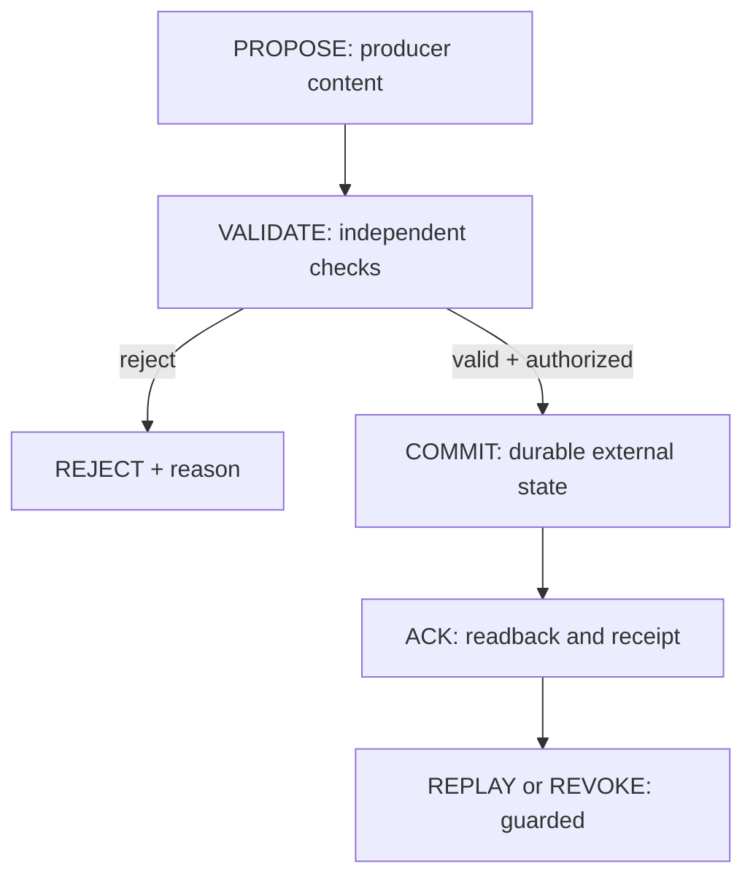

# StateBus v0: consented inter-model state exchange (proposed protocol)

**Evidence status:** This is a **source specification and test target**, not a deployed bus, native ChatGPT hook, connected Qwen runtime, proof of identity continuity, or mechanism for copying weights. Historical base `601907eb225ffb75d71ceb467af778156f486861` implemented only exact-base *toy* tensor transfer and categorical SGD experiments. Subsequent merged source PRs [#9](https://github.com/thebrazenbeard/neuro-sync/pull/9) and [#10](https://github.com/thebrazenbeard/neuro-sync/pull/10) add a **local SQLite StateDelta/StateLedger and bounded import/export/loopback bridge**, respectively. These are tested source APIs, **not** an independently witnessed, networked or ChatGPT-installed runtime. Inspect their exact newer Git head and hostile regressions before applying any security claim.

The separate [zero-weight scripted pilot merged as PR #12](../experiments/zero-weight-sync/README.md) implements a **local mechanics fixture** with different frozen mock A/B renderers, A-origin capability observation and host callback, scoped SQLite state, untouched mock model artifacts, no-state/decoy/expiry/forged-A controls, and a fresh B-only process. The source's host tool registry is already installed by the test; A does **not** autonomously invent or learn the tool. Local callbacks run in the same trust domain, so an apparently valid host result is **not** independent external authority or real local-Qwen/ChatGPT interoperability. The fixture tests a narrower local JSON/SQLite profile, not RFC 8785 wire interoperability or generalized cognition.

## Purpose and the three distinct paths

Patrick's objective is to allow model A and model B to exchange useful, explicitly authorized information and—where technically supported—transfer skills. A shared conversation, persistent external memory, and changing a model's parameters are **three different outcomes**. StateBus coordinates them but never makes one imply another.

| Path | Data exchanged | What changes in B? | Persistence proof | Nonclaim |
| --- | --- | --- | --- | --- |
| **A — compatible weight transfer** | Donor checkpoint or adapter delta plus exact version/schema/rights provenance | Recipient model parameters or adapter, after an explicit authorized update | Independent B artifact hash/shape/value change, cold B-only process, donor offline, held-out functional test and rollback | Transmitting weights does not imply architectures/semantics are compatible |
| **B — trained distillation** | Authorized donor answers, distributions or activations and aligned examples | B's **own** learned parameters/adapter after B-local optimization | Training receipts, no hidden teacher inference, restart B-only from its artifact, controls and compute matching | Repeating donor output in context is not B learning |
| **C — zero-weight StateBus** | Typed facts, tasks, perspectives, provisional state, evidence and citations over a mediation surface | Only **external state/context**, unless a separately authorized A/B training path runs | Durable authorized log/state readback across fresh sessions; hashes/sequence/provenance | Shared state is **not** a neural weight change, common consciousness, or native ChatGPT memory installation |

Path C should be useful even if A/B research fails. Paths A and B may send *receipts* over C, but C's `COMMIT` event alone must never invoke a weight writer, tool execution, or identity/memory promotion.

## Surfaces and authority boundaries

1. **Immediate client-mediated ChatGPT exchange (proposed):** A user-authorized client, tool, or orchestrator reads an assistant message, explicitly sends a bounded representation to another authorized session, and records both message IDs. That can provide cross-session *context*; it does **not** supply a native streaming token/activation hook, access ChatGPT's hidden weights, or install a permanent overlay inside ChatGPT. A model response is untrusted producer content, not trusted executor authority.
2. **Optional installed ChatGPT MCP tool (requires qualification):** [OpenAI's custom MCP server guidance](https://developers.openai.com/api/docs/guides/custom-mcp-server) and [connector/MCP documentation](https://developers.openai.com/api/docs/guides/tools-connectors-mcp) describe custom tool surfaces through a configured Server URL or Secure MCP Tunnel and installation/authentication. An explicitly installed and consented **StateBus MCP server** could expose bounded `propose`, `validate`, `commit` or `read` tools to a supported ChatGPT client. This is **tool calling**, not access to native token/activation streams or model weights. It is **not installed or authenticated by this source spec**; actual plugin installation, tool discovery, principal, grant and roundtrip must be checked before use. A Secure MCP Tunnel may need Platform credentials and could incur platform/network usage; **verify entitlement, permissions and exact `$0` cost before choosing it**. This proposal does not mandate a paid Responses API or any paid transport.
3. **Local model endpoint (future, qualified):** a separately configured local server (for example an explicitly selected local Qwen runtime) may expose a request/response API to an authorized mediator. Do not assume any specific VN2/Lappy process, port, model or checkpoint is available for a **new** job merely because a historical session saw it running. Verify device identity, model **exact revision/hash**, current memory/resource headroom and active workload, endpoint protocol, network boundary, permissions and `$0` cost before effects. A 35B model or a 50-turn run must not be reported as executed absent a real machine trace and evaluation artifacts. Qwen3.5-4B is a candidate **only when current host readback qualifies it for this particular workload**; loaded does not mean idle or safe to restart.
4. **External independent authority:** operator/rights-holder approval, capability resolution, validator identity, and durable commit custody are distinct from A/B and from the StateBus writer. Neither the producer nor a self-reported “host attestation” is automatically a trustworthy verifier. A host broker independently checks issuer, active principal/session, operation, target, scope, expiry and revocation before every protected effect.

The StateBus bridge is **model-agnostic at its message envelope**, not automatically compatible with a model's tokenizer, activation coordinates, adapter layer names, checkpoint format, execution semantics, or identity claims. Translators for structured representations require their own source revision, tested schema mapping, loss/precision limitations and grant.

## Envelope v0 contract

The authoritative human-readable schema for this proposed version is **this section** (`docs/STATEBUS.md#envelope-v0-contract`). `statebus-v0` is a short protocol identifier, **not an invented resolvable URL or an installed JSON Schema**. Before machine validators claim conformance, persist a real versioned schema file and test it against both valid and adversarial fixtures.

The **proposed cross-runtime wire profile** uses [RFC 8785 JSON Canonicalization Scheme (JCS)](https://www.rfc-editor.org/rfc/rfc8785.html), constrained to its valid I-JSON subset (no NaN/Infinity, duplicate object keys, malformed Unicode or implicit type coercion). JCS has specific ECMAScript-compatible number encoding and UTF-16-key sorting; ordinary Python `json.dumps(sort_keys=True)` is **not** automatically equivalent. This protocol does not claim implemented JCS conformance until cross-language golden vectors—including Unicode property ordering, numeric precision and negative-zero cases—pass in every producer/consumer. Source-local serialization may continue to use a narrower format and must **not** be mislabeled wire-interoperable. The envelope fields are:

| Field | Required | Contract |
| --- | --- | --- |
| `protocol_version`, `event_type` | Yes | Literal `statebus-v0`; event type from the state machine below |
| `event_id`, `stream_id`, `session_id`, `session_epoch`, `seq` | Yes | Unique event ID, stream and session identifiers; nonnegative epoch and monotone sequence **per session+epoch** |
| `sender`, `recipient`, `producer_surface` | Yes | **Untrusted claimed identifiers** and revision fingerprints where known; surface may claim `client-mediated`, `local-endpoint`, or `fixture`, never `native-hook` without independent proof. Broker must derive the actual principal/surface from the authenticated channel, not from these strings |
| `state_family`, `claimed_evidence_class` | Yes | Typed family such as `TRANSIENT_CONTEXT`, `FUNCTIONAL_STATE`, `MEMORY_STATE`, `PLASTIC_STATE`, `IDENTITY_CLAIM`, `TOOL_REQUEST`; producer-claimed evidence `DOC`, `SOURCE_INSPECTION`, `TEST`, `RUNTIME_PROBE`, `HUMAN_REVIEW`, `MODEL_REVIEW`, or `UNKNOWN`. **This field carries no authority** before a separate `Attestation.verified_evidence_class` and subject-bound check |
| `payload_type`, `payload`, `payload_sha256` | Yes | Bounded type-specific JSON body, content hash over exact **canonical payload**; never a sample/fabricated hash |
| `parent_event_id`, `previous_event_sha256` | Yes (null on genesis) | Causal and per-stream chain references; validate correct ancestry and reject forks |
| `created_at`, `expires_at`, `nonce`, `idempotency_key` | Yes | UTC canonical times, finite TTL, unique replay nonce and operation-specific dedupe key |
| `authorization_ref`, `provenance_refs` | Yes (can be empty/null for non-effect proposals) | References to **external** signed/verified rights grants and exact source/artifact/test hashes; strings have no inherent authority |
| `producer_claims`, `privacy_class`, `promotion_target` | Yes | Plain untrusted producer assertions **without a `verified` Boolean**, information handling tier, proposed promotion destination or null; never auto-authoritative |

Size limits, allowed event types, time skew, sequence-gap window, pending TTL, retry budget and private payload handling must be specified by a **versioned implementation configuration** before network exposure. Unbounded buffers and silently truncating evidence are forbidden.

**Hash and signature rules:** on a **qualified JCS implementation**, `event_sha256 = SHA256(JCS envelope bytes excluding event_sha256 and transport framing)`. `payload_sha256` is computed over JCS payload bytes, not pasted example text. Until JCS cross-runtime tests pass, declare a distinct explicitly versioned local serialization profile and do not compare its digests as interoperable wire hashes. Both hashes are integrity aids, **not signatures**; anyone who can rewrite the event can recompute either. Independent signatures/secret management and trusted durable witness custody remain unimplemented in the baseline. No fake SHA examples or unverifiable transcript statistics belong in receipts.

### Event lifecycle

`PROPOSE` is inert. `VALIDATE` requires a **separate validator** checking an exact payload hash, source/artifact identity, grant, provenance, epoch/sequence and type-specific invariants. Producer `producer_claims` cannot contain an authoritative `verified: true` or `pass` flag; assertions are merely data. A separate **Attestation** record binds `verifier_id`, verifier method/version, observed subject hash, input hashes, `verified_evidence_class`, assertions executed, exact runner/process/exit status and outcome. A test receipt must pin source Git head, test binary/version, input split hashes, exact assertion, execution environment and observed exit code—not just “tests passed” or a meaningless count of parsed nodes.

**Validator-capture adversary:** a model could supply both a malicious artifact and a trivial test program that exits `0`, then attach a plausible `TEST PASS` note. The independent validator must fetch and pin an **operator-approved exact test/policy hash** from outside the producer's control; producer-provided executables, assertions, fixtures and output text cannot authorize their own validation. No amount of model agreement upgrades a tautological passing test into a valid external attestation.

`COMMIT` means **external StateBus custody** after authorization and an append that is durable against the declared failure model. Commit requires independent readback/witness. A model's own claims, a forged `host=true` string, or a single producer-controlled log cannot qualify. For `MEMORY_STATE`, `PLASTIC_STATE` and `IDENTITY_CLAIM`, **additional explicit promotion events and separate authority are required**; receiving `TRANSIENT_CONTEXT` or `FUNCTIONAL_STATE` never silently promotes it to long-term memory, personal identity, or weights. A committed message is still not necessarily *true*.

**Two meanings must not be conflated:** a source implementation may expose a method named `StateLedger.commit()` that performs a **local append/state transition only**. Until external independent custody/readback is qualified, its honest receipt class is `LOCAL_APPEND_UNWITNESSED` with `witnessed=false`. It must **not** advertise the protocol-level `COMMIT`/`ACK` above or independent authority merely because local file I/O succeeded. A restart/replay test may show recoverability under the tested filesystem/failure assumptions; it does not demonstrate independent witness, consensus, or resilience to arbitrary power loss.

`ACK` is idempotent and refers to an exact committed event hash/offset. Upon crash or restart, replay only a fsynced, externally witnessed valid prefix, reject duplicate IDs with different hashes, reject forks/expired grants and verify per-session sequence/epoch. An effectful downstream tool invocation needs an **independent idempotency receipt** so replaying a bus message cannot repeat a mutation. If append succeeded but ACK failed, resend returns prior receipt without applying effect again. A capability reference is never itself permission to execute.

### Implemented local source boundary (not trusted external runtime)

The merged [StateBus core PR #9](https://github.com/thebrazenbeard/neuro-sync/pull/9) added `src/neurosync/bus/{schema.py,ledger.py,__init__.py}` and `tests/test_bus_core.py`. Its source API includes `StateDelta.create(...)` with `StateOp.SET`/`DELETE`, **`expected_revision` for target/session/key compare-and-swap**, and `EvidenceBinding(artifact_sha256, source_git_commit_oid, source_tree_sha256, host_test_receipt_sha256, evidence_class)`. `source_git_commit_oid` is the **actual typed Git object ID** (`sha1:` plus 40 lowercase hex digits, or `sha256:` plus 64), **not a mislabeled SHA-256 Git head**. `source_tree_sha256` is a separate 64-hex content digest of a declared canonical source-tree artifact, not the Git OID. Both are producer-declared until independently fetched/checked. The ledger implements `StateLedger(path).propose(...) → validate(...) → commit(...) → project(...)`, `get_revision(target_id,session_id,key)` and chain verification. Its consistency scope is one owner per target/session/key with stale-write rejection, **not** CRDT multiwriter convergence or distributed consensus. It remains **local source-level state**, not a trusted remote witness, authenticated identity provider, model-weight updater, native ChatGPT memory store, or complete implementation of this document's higher-level envelope. A callback named `verify_validator` is not automatically independent; qualify its actual principal, trust root, checks and test receipt. No fabricated example commit hash is supplied here.

The merged [bridge PR #10](https://github.com/thebrazenbeard/neuro-sync/pull/10) added a **user-mediated export/import adapter** (`src/neurosync/bus/bridge.py`) and an optional explicitly authorized **loopback** OpenAI-compatible local model endpoint. Neither makes ChatGPT's weights/token stream accessible. Its `tests/test_bus_bridge.py` exercises bounded JSON and fake hostile responses; its source suite ran against the actual StateBus core after integration. The wire envelope, ledger implementation, bridge protocol and rights authority must each be tested and versioned before they can be called interoperable. The current bridge is a narrow local JSON profile, **not** qualified RFC 8785 JCS wire interoperability.

## Privacy and threat model

| Attack / failure | Required defense and observable test |
| --- | --- |
| Forged `verified: true`, `host-attested`, or model authority | Independent verifier and broker reject producer self-certification; check exact principal, role, revision, hash and rights |
| Replay, same ID/different payload, reordering, forked chain | Epoch+sequence, canonical hash, nonce, bounded gap, idempotency, independently pinned checkpoint, TTL/revocation; adversarial replay/rechain fixtures fail |
| Tampered SQLite index metadata | Modify stored session/target/source index columns while leaving `event_json`/its hash unchanged (including after an attacker drops a trigger). `verify_chain()` and projections must compare **every indexed authority-relevant column** with the canonical parsed event; no cross-session disclosure. A hash chain of JSON alone does not authenticate mutable index columns |
| Cross-session/tenant context leak | Strict sender/recipient/session binding, opt-in scope, redaction and classification; disallowed recipient/cross-session fixture fails |
| Prompt injection in model output or tool result | Treat data as quoted content, not policy/command; no implicit tool execution or state promotion |
| Stale capability or revoked grant | Re-resolve at use time against separate issuer/broker; fail closed on protected effect, keep unrelated research moving |
| Crash between append, commit, ACK and effect | Fsync + witness + idempotent downstream receipts; recovery test shows no duplicate side effects |
| Tokenizer/checkpoint/schema mismatch | Explicit compatibility contract and negative tests, never infer from same tensor width or semantic similarity |
| Secret or private oracle leakage | Inject unique sentinel secret into local prompt fixture; assert absent from public bus logs, CI artifacts, error traces and model-visible transcript after redaction |
| Unbounded streaming/cost or unavailable host | Hard payload/turn/byte/time quotas, backpressure and timeout; no paid service or unapproved host restart |

StateBus must not publish model weights, proprietary datasets, confidential prompts, credentials, private evaluation oracles, or personally identifying context by default. Evidence citations and hashes may themselves leak metadata; privacy review precedes logging. Public CI uses fabricated synthetic fixtures only, not real user conversations or authenticated external connections.

## Minimal qualification matrix

1. **Schema/transport mechanics:** deterministic encode/decode/hash; duplicate-key and invalid-type refusal; cross-runtime JCS Unicode, negative-zero, decimal precision and property-ordering vectors; proposal-only message has zero effects. No connection or exchange is proven by unit tests alone.
2. **Authority/recovery:** forged verification, replay/reorder, cross-session, expired/revoked grant, altered payload, previous-hash fork, malicious promotion, crash-between-append/ACK, stale tool capability and secret sentinel all rejected or safely recovered. Distinguish producer claims from independent validators.
3. **Path C zero-weight:** fresh A/B sessions show *no-state*, *authorized state*, *stale/decoy state* controls. Query the same independently sealed task set; prove changed responses are attributable to delivered context **without** checkpoint change. Reopen session, read authorized external state under scope, and verify it is unavailable when revoked. This is mediation, not native memory.
4. **Path A weight copy:** receiver-only fresh process after donor disconnect, exact B checkpoint hash/contents, rollback, base/schema mismatch, no-state/full-copy/shuffle controls. Compare capability against untouched B independently; numeric tensor match alone is not knowledge generalization.
5. **Path B distillation:** donor offline during B-only scored evaluation, B artifact changed, held-out taught-fact *paraphrases* distinct from never-taught negatives, teacher-output and shuffled baselines, matched total A+B training compute, multiple seeds and negative-transfer checks.
6. **Real endpoint / streaming (future):** first obtain explicit permission and probe exact host/model revision, transport, local process and $0 resource budget. Report actual turns/messages, timestamps, tested model (e.g. Qwen3.5-4B **only if actually qualified**), path/byte logs and independently scored results. No invented 50-turn receipts, nonexistent Qwen3.5-35B experiment, native ChatGPT hook or blanket “100%” outcome.

Success in item 1 or 2 qualifies a source-level bus component for **its exact tests only**. Items 3–6 require separately observed traces and independent scoring before claims about behavior, persistence, native operation, or interoperability. The Path C transport and governance layer may be implemented before any model-weight experiment reaches scientific qualification.

**Required cold-restart triad:** evaluate identical sealed tasks with B freshly restored under **(A)** no bus/no memory, **(B)** read-only bus retrieval with **unchanged B weights**, and **(C)** a separately authorized, hashed **changed B weight artifact** with the bus disconnected. If only B improves, the result is external memory/context mediation. Only C's donor-offline advantage over A supports a persistent weight-transfer hypothesis; even then, it does not establish self-awareness or a unified cognitive topology.

## External tools and `$0` budget

Default to isolated CPU source tests and standard free public-repository GitHub Actions without model downloads, caches, artifacts, paid APIs, GPU runners or host deployment. A future user-authorized Lappy/VN2 endpoint must be qualified from actual host readback. No task in this spec grants permission to edit or restart a machine, copy private weights, broaden access, upload data, or write to an external shared Blotter. The shared Blotter is distinct from StateBus; never create a substitute ledger when its authenticated route is unavailable.

### Portfolio design references, not runtime bindings

The user-owned `ccb-core` repository contains a SQLite transactional lifecycle **source pattern**; `chat-communication-bus` public GitHub issues are coordination history, **not** a deployed private mailbox. `rezon` has local receipt/replay design material, **not** independently authenticated distributed consensus. `semanticatlas` distinguishes source, inference, authority and temporal validity. `deepmemorystorage` is a historical source archive, **not** an approved training dataset or live memory runtime; `MemoryLedger` has not established an implemented shared ledger in the inspected baseline. These can inform adapters **after exact license, current source and implementation checks**. No code was copied, connected, installed, or qualified by naming them here. The conceptual BT2 Hyperconnectome and Plasticity/State Governance project sources likewise provide governance questions, not deployed components.
